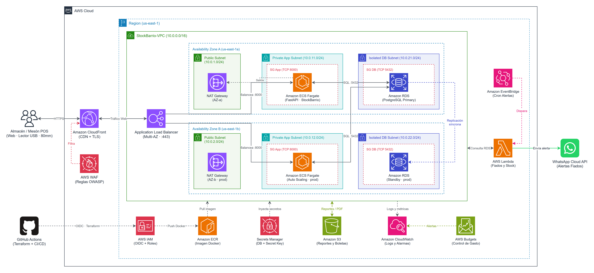

# StockBarrio AWS — Arquitectura Cloud Resiliente, Segura y Escalable

> **Estado:** En desarrollo — **Fase 1: Diseño de Arquitectura y Análisis FinOps** *(implementación de módulos Terraform en progreso)*.

Repositorio personal de infraestructura en **Amazon Web Services (AWS)** basado en la plataforma SaaS de inventario y punto de venta **StockBarrio** (FastAPI + Jinja2 + PostgreSQL), diseñado bajo principios del *AWS Well-Architected Framework* con **Terraform** y enfoque **IaC Efímero (`dev` / `prod`)**.

> **Relación con el proyecto de aplicación:** Este repositorio sigue el patrón de separación *App Repo / Infra Repo*. El código fuente colaborativo de la aplicación académica vive en su propio repositorio de desarrollo, mientras que este repositorio está dedicado exclusivamente al diseño de arquitectura, estimación de costos e Infraestructura como Código (IaC) en AWS.

### Hoja de Ruta

- [x] **Fase 1:** Diseño de arquitectura Multi-AZ, diagrama oficial AWS4 y estimación de costos (`dev` vs `prod`).
- [ ] **Fase 2:** Módulos Terraform (`vpc`, `ecs`, `rds`, `s3`, `cloudfront-waf`, `alerts`).
- [ ] **Fase 3:** Pipeline CI/CD en GitHub Actions con IAM OIDC y pruebas de despliegue efímero (`apply` / `destroy`).

---

## Arquitectura Cloud



### Flujo de Trabajo y Rol de cada Servicio

1. **Mesón del Almacén y Periféricos Locales (`Navegador` + `Lector USB` + `Impresora Térmica 80mm`):**
   - Los periféricos del mesón **no se conectan directo a AWS**, sino al equipo local que ejecuta el navegador web:
     - **Lector de código de barras USB (1D/2D):** Opera en modo teclado (*HID*). Al escanear, escribe el código + `Enter` en el POS web y dispara la búsqueda contra la API en AWS.
     - **Impresora térmica 80mm:** El navegador genera e imprime el comprobante interno usando CSS `@media print` en formato 80mm (permite simular e imprimir a PDF incluso sin hardware físico).
   - Toda la operación comercial viaja por **HTTPS** hacia la nube, sin depender de servidores locales ni VPNs.

2. **Borde y Seguridad Perimetral (`CloudFront` + `AWS WAF`):**
   - **Amazon CloudFront** entrega TLS, cachea los activos estáticos (`/static/css`, `/static/js`) y reduce la latencia hacia el origen.
   - **AWS WAF** protege el borde con reglas administradas (OWASP Top 10) y *rate limiting* sobre el inicio de sesión por PIN (`/api/v1/auth`).

3. **Balanceo y Red Privada Multi-AZ (`VPC` + `ALB` + `NAT Gateway`):**
   - El **Application Load Balancer (ALB)** distribuye el tráfico entre `us-east-1a` y `us-east-1b` y valida continuamente el estado de las tareas con `/api/v1/health`.
   - Los **NAT Gateways** permiten salida controlada a Internet desde las subredes privadas sin exponer nunca IPs públicas en los contenedores.

4. **Cómputo Escalable sin Servidores (`Amazon ECS Fargate`):**
   - **FastAPI** corre contenerizado en subredes privadas (`SG App :8000`, accesible solo desde el ALB).
   - Gracias a las sesiones firmadas *stateless* (`itsdangerous`), **ECS Service Auto Scaling** escala horizontalmente entre ambas AZs sin cerrar turnos de caja activos.

5. **Base de Datos Aislada y Transaccional (`Amazon RDS PostgreSQL`):**
   - Almacena de forma transaccional (ACID) todo el registro operativo: **ventas, detalle de ventas, folios de comprobantes, movimientos de stock, sesiones de caja (arqueo Z), clientes, fiados y abonos**.
   - Vive en subredes aisladas sin acceso a Internet (`SG DB :5432`, solo desde `SG App`). En `prod`, **RDS Multi-AZ** replica síncronamente hacia `us-east-1b` con *failover* automático.

6. **Alertas Automáticas Asíncronas (`EventBridge` + `AWS Lambda` + `WhatsApp Cloud API`):**
   - **Amazon EventBridge** dispara de forma programada (diaria o semanal) una función **AWS Lambda** completamente desacoplada del POS, sin interrumpir el flujo de caja.
   - La Lambda consulta en **RDS** los clientes de confianza con deuda de fiado pendiente (~5–10 clientes por almacén) y los productos próximos a vencer o en stock crítico, y envía recordatorios a través de **WhatsApp Cloud API** (compatible con modo *Sandbox* de Meta para pruebas sin costo).

7. **Almacenamiento de Reportes, Comprobantes y Respaldos (`Amazon S3`):**
   - Bucket privado con bloqueo de acceso público y prefijos por almacén (`almacenes/<id>/reportes/`, `boletas/`, `respaldos/`).
   - Guarda reportes exportados (cierres de caja Z, inventario, ventas en PDF/CSV), copias de comprobantes y respaldos, con reglas de *Lifecycle* para optimizar costos.
   - ECS se conecta a S3 mediante un **S3 Gateway VPC Endpoint (sin costo)** para no consumir tráfico del NAT Gateway, y entrega **URLs prefirmadas (*Presigned URLs*)** temporales al navegador para descargar cada archivo de forma segura.

8. **CI/CD, Secretos, Observabilidad y FinOps (`GitHub Actions` + `IAM` + `ECR` + `Secrets Manager` + `CloudWatch` + `Budgets`):**
   - **GitHub Actions** se autentica vía **IAM OIDC** (sin claves estáticas), sube la imagen Docker a **ECR** y gestiona los entornos `dev`/`prod` con **Terraform**.
   - **Secrets Manager** inyecta `DATABASE_URL`, `SECRET_KEY` y el token de WhatsApp en tiempo de ejecución.
   - **CloudWatch** centraliza logs y alarmas de escalado; **AWS Budgets** controla el gasto y alerta sobre el consumo de créditos.

---

## Estrategia de Entornos y Costos (`dev` vs `prod`)

| Recurso | Modo `dev` (Pruebas / Demo) | Modo `prod` (Alta Disponibilidad) |
| :--- | :--- | :--- |
| **NAT Gateway** | 1 en AZ-a | 2 (AZ-a y AZ-b) |
| **ECS Fargate** | 1 tarea (`0.25 vCPU / 0.5 GB`) | 2+ tareas con Auto Scaling Multi-AZ |
| **RDS PostgreSQL** | `db.t4g.micro` Single-AZ | `db.t4g.micro` Multi-AZ (Primary + Standby) |
| **EventBridge + Lambda** | Activo (\$0 Free Tier + Meta Sandbox) | Activo (\$0 Free Tier + tarifa Meta) |
| **Amazon S3 + Gateway Endpoint** | Activo (~centavos/mes, Endpoint \$0) | Activo con Lifecycle + versionado |
| **WAF** | Opcional (desactivable por variable) | Activo con reglas OWASP + rate limit |
| **Costo si corre 24/7** | ~\$60 USD/mes | ~\$100 – \$145 USD/mes |
| **Costo efímero (ej. 20 h/mes)** | **~\$2 – \$4 USD/mes** | **~\$4 – \$6 USD/mes** |

> Al levantar el entorno solo para pruebas o demos y apagarlo con `terraform destroy`, el gasto real es mínimo frente a mantener la infraestructura encendida todo el mes.

---

## Estructura del Repositorio

```text
stockbarrio-aws/
├── docs/
│   ├── architecture.drawio   # Diagrama editable en Draw.io (iconos oficiales AWS4)
│   └── architecture.png      # Exportación en alta resolución (2x)
├── terraform/                # (Próxima fase) Módulos Terraform dev / prod
└── README.md
```
